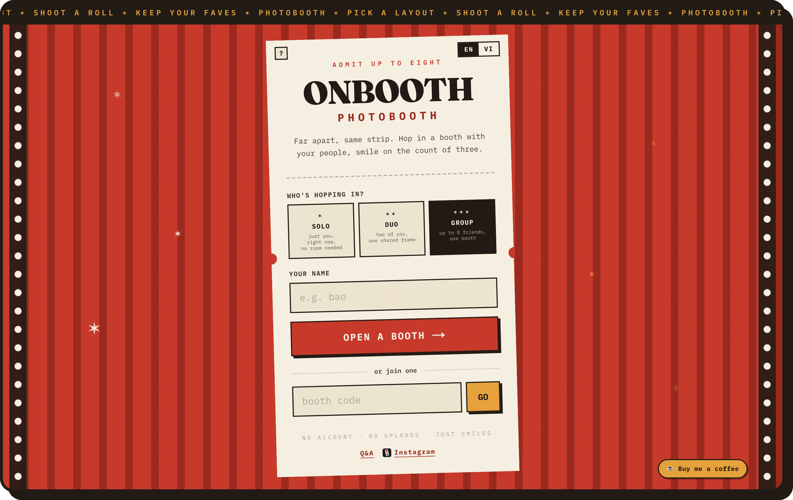
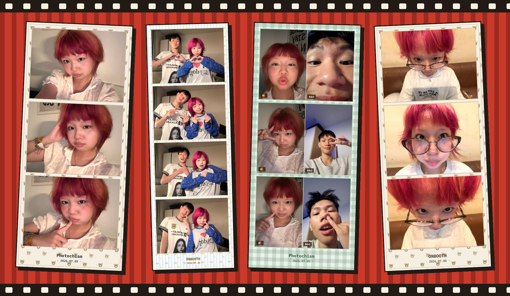
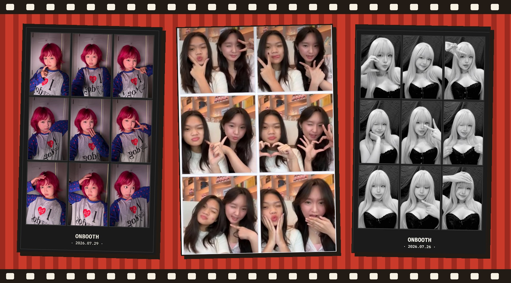
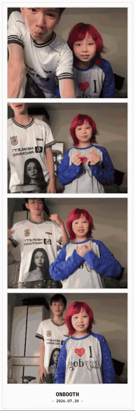
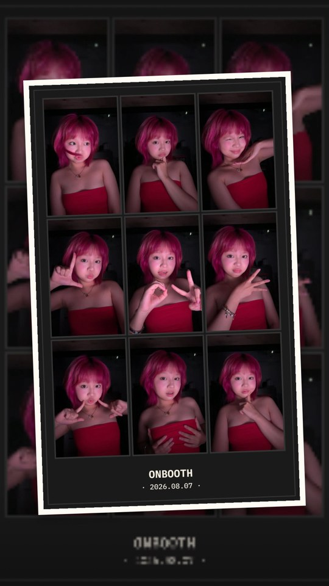
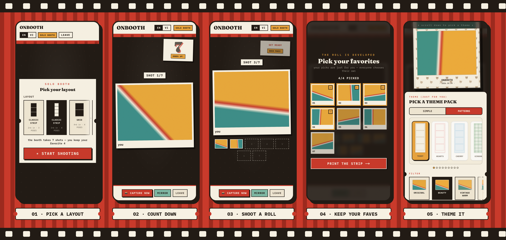
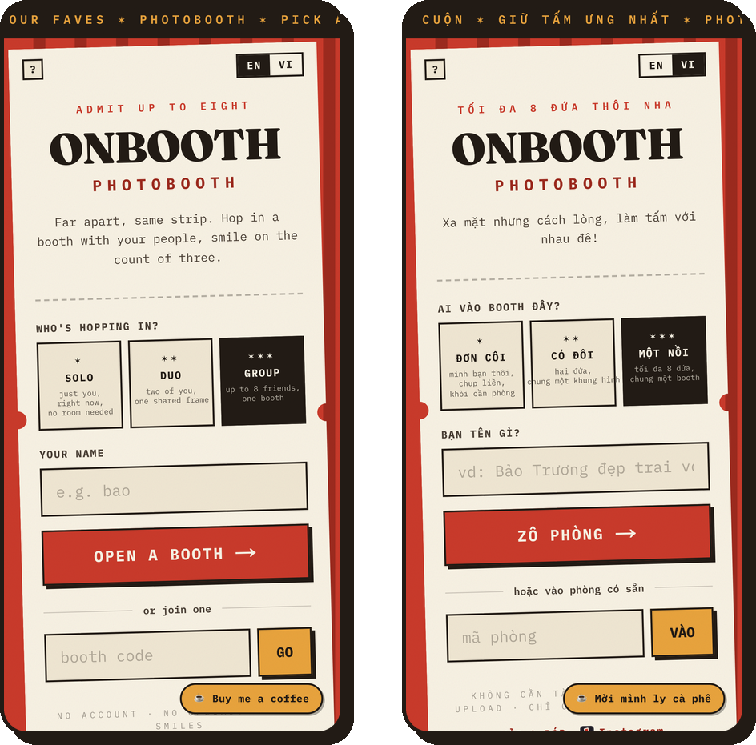
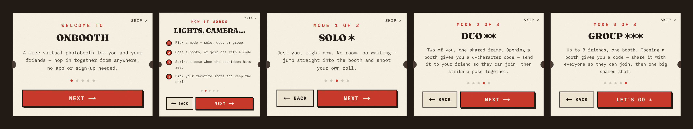
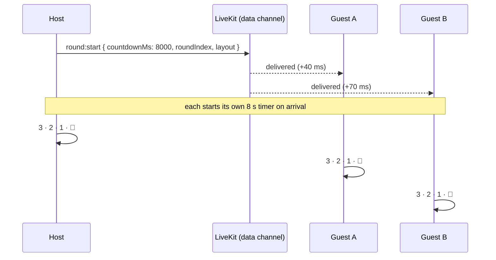
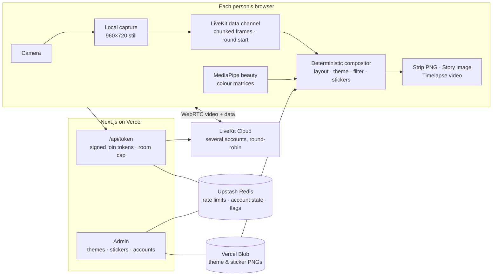

# ONBOOTH

**Far apart, same strip.**
A virtual photobooth for friends in different places: everyone joins live on video, one countdown, one shared photo strip.
No app, no sign-up, up to 8 people.

 

 

> [!NOTE]
> This repo is a **showcase**. ONBOOTH's source code is private; here you'll find what it does, how the real-time part works, and how it was built.

## 📸 Straight out of the booth

Real strips made with ONBOOTH, shared with permission. (The early ones still carry its first name, *Photochism*.)

<table>
<tr>
<td width="50%" align="center">
 
<b>Timelapse video</b> Every slot replays its own countdown, inside the real strip
</td>
<td width="50%" align="center">
 
<b>Share to Story</b> One tap to an Instagram or Facebook Story
</td>
</tr>
</table>

> The mint gingham strip above is a **Duo**: two phones in two different places, one shared frame.

 

The booth shoots a **roll** (more shots than the layout needs), you keep your favourites, and the
strip is printed in your browser. Picks, theme and filter are **just for you**: in a group, everyone
gets the same shots but chooses their own strip.

 

### 👥 Three ways in

| Mode | How it works |
| :--- | :--- |
| **Solo ✶** | Just you, right now. No room, no waiting: straight into the booth. |
| **Duo ✶✶** | Two of you squeezed into **one shared frame**, side by side, like sharing a booth stool. Open a booth, send your friend the booth code. |
| **Group ✶✶✶** | Up to **8 friends** on a live video grid, one big shared shot on the count of three. |

### 🎞️ Strips that feel printed

- **Layouts** like the wall of a real booth: classic 2×6 strips, 4×6 grids up to **3×3**, a big print, a collage, a polaroid stack
- **Themes**: plain paper colours, procedural patterns (teddy, hearts, cherry, gingham…), and designed PNG **frame themes**
- **Stickers**: place, resize and rotate them on the finished strip
- **Filters**: vintage warm, classic film, black & white, warm sun, nordic cool, all on top of a **face-aware beauty mode**
- A date stamp in the footer, like the real thing

### 🎬 More than a photo

- **Timelapse video**: the whole posing session replayed *inside the strip layout*, each slot animating its own round
- **Share to Story**: a ready-made Instagram/Facebook Story image, each theme with its own backdrop
- Downloads stay on your device; **no uploads, no account**

### 🌏 Made for its audience

<table>
<tr>
<td width="55%"></td>
<td>

- Fully bilingual **English / Tiếng Việt**, with copy written for each language, not translated word-for-word (*"Xa mặt nhưng cách lòng, làm tấm với nhau đê!"*)
- A first-visit **tutorial** that explains modes and booth codes
- Installable as a **PWA**, with wake lock so phones don't sleep mid-countdown
- Mobile-first: spotlight on your own tile, guards against an accidental back-swipe losing a shoot
- SEO for both languages: structured data, FAQ pages, `/vi` routes

</td>
</tr>
</table>

 

Getting up to eight phones and laptops to take *one* photo together, over home Wi-Fi and 4G, is the
whole product. A few of the problems that took the most iterations:

<b>One countdown on every device</b>

 

The first version broadcast a **future wall-clock timestamp** ("shoot at 12:00:05.000") so message
jitter couldn't desync anyone. Real phones broke it: device clocks drift by *seconds*, and a guest
phone running fast saw a time already in the past and **skipped its countdown entirely**.

Now the host sends a **countdown length**, and every client starts its own timer the moment the
message arrives. Data-channel delivery differs by well under 100 ms between clients, which nobody
can see, and no one's clock matters anymore.

<b>Photos that don't depend on the video call</b>

 

A live video stream is compressed and resized constantly, so shooting from it made blurry strips.
Each device now captures its **own** photo locally at 960×720 (a full-sensor still via
`ImageCapture` where the browser supports it, a video frame on iOS Safari and Firefox) and only then
sends it to the others.

Photos travel over LiveKit's **data channel**, split into chunks under the packet limit and
reassembled on arrival. Every client then runs the **same deterministic compositor**: same layout
maths, same procedural pattern grid, same fonts. So everyone's download is pixel-identical, with no
server ever touching an image.

<b>Duo: instant now, full quality a moment later</b>

 

Waiting for your partner's photo to arrive before showing the shot made every round feel laggy. So
each side builds the shared frame **locally** from its own camera plus the partner's live video:
instant, never waits on the network. In the background, both sides buffer their real full-quality
stills and exchange them **once, after the roll**. Each round is then silently upgraded to the sharp
version. You never wait, and you still keep the good photo.

<b>Staying up on free tiers</b>

 

A free LiveKit project has a hard monthly cap; when it's spent, the booth stops connecting. ONBOOTH
runs on **several LiveKit accounts**:

- New rooms are **round-robined** across accounts that are up, with a shared cursor in Redis
- The account is encoded **in the room code itself** (`d3k7mpq`: mode, account, random part), so a
  friend opening the link connects to the right project with no lookup
- A client that hits a dead account **reports it**, the account is marked down, and new rooms route around it
- An admin page shows each account's state and can flip one up or down by hand, plus a **kill
  switch** that pauses Duo and Group with a friendly out-of-service card while Solo keeps working

Room codes skip `0/o/1/l` because people read them out loud over calls.

<b>Hardening a public, anonymous app</b>

 

- **Rate limits** (Upstash Redis) on token and room endpoints, with a stricter budget for malformed room codes
- **CSP** and security headers; WASM allowed only so the MediaPipe model can load
- **Data-channel input is untrusted**: chunk counts and indices are bounds-checked before allocating,
  image data URLs validated, concurrent reassembly buffers capped
- The room size cap is enforced when the server signs the join token
- Group calls use **adaptive streams + dynacast**, so each viewer pulls only the video quality its tile needs

<b>A beauty filter that isn't a blur</b>

 

The beauty mode runs **Google MediaPipe's Face Landmarker** in the browser, builds a feathered mask
of just the skin (face oval minus eyes, brows and lips), and applies an edge-preserving smooth-and-brighten
only inside it. Hair, eyes and background stay crisp. The model loads lazily the first time someone
picks it.

Colour filters are written as **3×4 colour matrices applied per pixel**, because iOS Safari silently
ignores canvas `ctx.filter`. A "Black & White" strip used to come out in full colour on iPhones.

 

| Layer | Stack |
| :--- | :--- |
| **App** | Next.js 16 (App Router), React 19, TypeScript, Tailwind v4, Zustand |
| **Real-time** | LiveKit Cloud (WebRTC): video for the live booth, data channel for control messages and photos |
| **Imaging** | Canvas compositor, MediaPipe Face Landmarker, per-pixel colour matrices, MediaRecorder timelapse |
| **Backend** | Next.js route handlers on Vercel: token signing, rooms, admin APIs |
| **Storage** | Upstash Redis (rate limits, account health, feature flags), Vercel Blob (frame themes, stickers, story backgrounds) |
| **Admin** | Theme editor that **auto-detects photo slots** by clicking a placeholder box (flood fill → convex hull → rotating-calipers minimum rectangle, so tilted slots work too) |
| **Design** | Fraunces + IBM Plex Mono, booth-curtain red, ticket-stub cards, film-strip edges |

 

Four weeks in July, from an MVP to a public, bilingual product.

| When | Milestone |
| :--- | :--- |
| **Jul 2** | MVP: up to 8 friends, a synced countdown, one composited strip. Host-gated capture, themes, i18n, more layouts |
| **Jul 3 – 4** | Multiplayer flow reworked (ready-up, shared layout picking, synced mirror). Group mode with an adaptive grid. Filters, the MediaPipe beauty mode, and the **timelapse video** |
| **Jul 5 – 6** | Real domain, SEO in both languages, `/vi` routes, illustrated share image, analytics |
| **Jul 7** | **Rebrand to ONBOOTH**. Photo capture decoupled from the live stream; rate limits, CSP and data-channel hardening |
| **Jul 8** | Share to Story; duo's instant-then-upgraded photos; faster solo capture |
| **Jul 9 – 13** | Admin panel with Redis + Blob storage: PNG frame themes, slot auto-detection, story backgrounds, **sticker mode** |
| **Jul 14 – 16** | **Multi-account LiveKit failover**, then round-robin across accounts |
| **Jul 19 – 21** | First-visit tutorial, installable PWA |
| **Jul 26 – 30** | 3×3 grid, capture-now button, longer countdown with a prompt beat; Duo/Group kill switch and out-of-service card; timelapse metadata fix; a donate button |

 

| 📅 4 weeks | 📝 130 commits | 👥 up to 8 per booth | 🌏 2 languages |
| :---: | :---: | :---: | :---: |
| **~13k** lines of TypeScript | **8** layouts | **3** booth modes | **0** accounts needed |

 

---

Designed and built by **[Bảo Trương](https://github.com/baotrq)** · [onboothvn.com](https://www.onboothvn.com)

